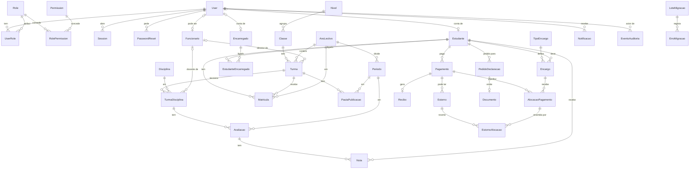

# Modelo de dados — Lá Manu (versão Entrega 0, a refinar na Entrega A)

Convenções: `id` UUID · `createdAt`, `updatedAt`, `createdById` · dinheiro em `BigInt` (cêntimos de Kz; 1 Kz = 100 cêntimos; ver §2.1) · `archivedAt` (soft delete) nas entidades académicas · **movimentos financeiros nunca se apagam nem editam**.

## 1. Diagrama ER

## 2. Entidades e campos principais

### Identidade e acesso
- **User**: email/username único, passwordHash (argon2id), estado (ACTIVO/BLOQUEADO/DESACTIVADO), tentativasFalhadas, bloqueadoAte, ultimoLogin, mfaActivo (opcional).
- **Role**: código (DIRECCAO, SECRETARIA, FINANCEIRO, DOCENTE, RH, QUALIDADE, ESTUDANTE, ENCARREGADO, ADMIN_TECNICO). **Permission**: código `recurso:acção`. **RolePermission**, **UserRole** (N:N).
- **Session**: tokenHash, expiraEm, ultimaActividade, ip, userAgent, revogadaEm.
- **PasswordReset**: tokenHash, expiraEm, usadoEm.

### Estrutura escolar
- **AnoLectivo** (nome, início, fim, estado PLANEADO/ACTIVO/FECHADO; **só um ACTIVO**: UNIQUE parcial).
- **Periodo** (anoLectivo, ordem, nome, início, fim; UNIQUE(ano, ordem)).
- **Nivel/Ciclo**, **Classe** (nome, ordem), **Turma** (classe, ano, turno, sala, directorTurma; UNIQUE(ano, classe, nome)).
- **Disciplina**, **TurmaDisciplina** (turma, disciplina, docente; UNIQUE(turma, disciplina)).
- **Funcionario** (user opcional, cargo; RH completo em fase posterior).

### Pessoas e matrículas
- **Estudante** (numeroProcesso UNIQUE, nome, dataNascimento, BI/cédula, contactos, estado).
- **Encarregado** (nome, BI, contactos, user opcional).
- **EstudanteEncarregado** (parentesco, verificado, autorizacaoActiva, principal, validoDe/Até; UNIQUE(estudante, encarregado)).
- **Matricula** (estudante, turma, anoLectivo, tipo NOVA/RENOVACAO, estado, data). UNIQUE parcial `(estudanteId, anoLectivoId) WHERE estado = 'ACTIVA'`. Turma e ano da matrícula têm de coincidir (verificação em transacção).

### Avaliação
- **Avaliacao** (turmaDisciplina, periodo, tipo, peso, data).
- **Nota** (avaliacao, estudante, valor, lancadaPor; UNIQUE(avaliacao, estudante); CHECK 0 ≤ valor ≤ 20 [D4]).
- **PautaPublicacao** (turma, periodo, estado RASCUNHO/VALIDADA/PUBLICADA, validadaPor, publicadaEm; UNIQUE(turma, periodo)). Portais só leem notas de pautas PUBLICADA. Edição pós-publicação exige motivo e gera `EventoAuditoria`.

### Financeiro (livro imutável)
- **TipoEncargo** (nome, valorReferencia, periodicidade).
- **Encargo** (estudante, tipoEncargo, periodoRef, valor ≥ 0, vencimento). Estado (PENDENTE/PARCIAL/PAGO/VENCIDO) **calculado**, não guardado.
- **Pagamento** (estudante, pagoPor opcional, valor > 0, método, referenciaExterna, data, registadoPor, estado REGISTADO/CONFIRMADO/ESTORNADO). Valor nunca editável. **Regra de estado:** `ESTORNADO` só quando Σ estornos APROVADOS = valor do pagamento. Estorno parcial mantém `CONFIRMADO`; o valor líquido (valor − Σ estornos aprovados) é calculado e mostrado no extracto e no recibo (nota "estorno parcial de X Kz"). Estorno PROPOSTO não altera o estado.
- **AlocacaoPagamento** (pagamento, encargo, valor > 0). Regra: Σ alocações ≤ valor do pagamento (verificada em transacção + constraint trigger).
- **Recibo** (série, número sequencial sem saltos, pagamento UNIQUE, pdfDocumento, emitidoPor). UNIQUE(série, número).
- **Estorno** (pagamento, motivo, proposto por, autorizado por ≠ proponente, valor > 0, estado PROPOSTO/APROVADO/REJEITADO). Estorno total ou parcial.
- **EstornoAlocacao** (estorno, alocação original, valor > 0): reverte, no todo ou em parte, uma alocação concreta. Regras (transacção + constraint trigger): Σ EstornoAlocacao de uma alocação ≤ valor dessa alocação; Σ EstornoAlocacao de um estorno = valor do estorno. Todos os valores permanecem positivos; o sentido é dado pela tabela. Só existe depois de o estorno ser APROVADO.
- **Saldo do encargo** = valor − (Σ AlocacaoPagamento − Σ EstornoAlocacao); **saldo do estudante** = Σ saldos dos seus encargos; vista/consulta, nunca coluna editável.

### Pedidos e documentos
- **PedidoDeclaracao** (tipo, estudante, solicitante, estado PEDIDO/EM_ANALISE/APROVADO/EMITIDO/REJEITADO, motivo, histórico).
- **Documento** (tipo, entidade ligada, caminho privado, hash SHA-256, emitidoPor).

### Transversal
- **Notificacao** (destinatário, canal APP/EMAIL, título, corpo, lidaEm).
- **EventoAuditoria** (actor, acção, entidade, entidadeId, antes, depois, ip, data) — só inserção.
- **LoteMigracao** / **ErroMigracao** (ficheiro, folha, linha, coluna, valor, motivo).

### 2.1 Unidade monetária (provisória — a confirmar com a escola)
- **Apresentação:** Kz inteiros, sem decimais (ex.: `15 000 Kz`).
- **Armazenamento:** `BigInt` em cêntimos (ex.: 15 000 Kz → `1500000`). Conversão única em `src/lib/dinheiro` (`kzParaCentimos`, `centimosParaKz`); nenhum outro código multiplica/divide por 100.
- `BigInt` (e não `Int` de 32 bits, máx. ≈ 21 milhões de Kz) para totais e relatórios não transbordarem.
- Importação Excel: valores em Kz inteiros → ×100; valores com decimais são rejeitados para revisão.

## 3. Integridade em base de dados
- Índices em todas as FKs e em nome, numeroProcesso, BI.
- CHECK em valores monetários; UNIQUE parciais (ano activo, matrícula activa).
- Triggers: bloquear UPDATE/DELETE em `Pagamento` (excepto transição de estado permitida), `AlocacaoPagamento`, `Estorno` (excepto transição de estado), `EstornoAlocacao`, `Recibo`, `EventoAuditoria`.
- Sequência de recibos por tabela de contadores com bloqueio de linha.

## 4. Questões em aberto
- Ligação Estudante–Encarregado: só um encarregado "principal" por estudante?
- Estados exactos da matrícula (ACTIVA, TRANSFERIDA, ANULADA, CONCLUIDA)?
- Transições de estado do Pagamento (REGISTADO→CONFIRMADO por quem?) — propor: Financeiro regista, Direcção/Financeiro sénior confirma (D3).
